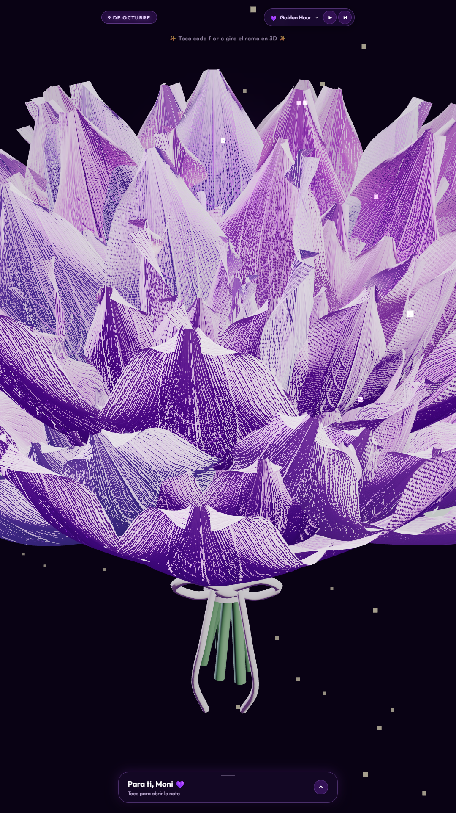

# Ramo de Flores Moradas • 9 de Octubre 💜

Experiencia interactiva 3D fotorrealista de alta costura floral creada con **Three.js** y **Web Audio API** para celebrar el día de las flores moradas (9 de octubre), dedicada exclusivamente para **Moni**.

## ✨ Características de la Versión Final

- **Ramo (Bouquet) Botánico 3D en Three.js:**
  - Composición magistral de **7 Flores Moradas Hiperrealistas**: 1 Flor Reina central dominante (escala 0.95) y 6 flores en corona radial en domo hexagonal, todas en floración plena con **40 pétalos en espiral áurea de Fibonacci** distribuidos en 5 niveles concéntricos.
  - Follaje botánico de relleno: Ramas de **eucalipto plateado** con hojas cerosas orbiculares decusadas y corona basal de 9 hojas de rosa botánicas.
  - Atado de tallos convergentes con **lazo tridimensional de seda satinada** (fajín cilíndrico, nudo central, orejas 3D y colas colgantes con drapeado natural).

- **Texturas Procedurales PBR de Alta Resolución:**
  - Mapas de Albedo aterciopelado, Normal/Bump con micro-relieve papilar vegetal y Roughness generados en HTML5 Canvas (1024x1024).
  - Materiales con dispersión subsuperficial física (*MeshPhysicalMaterial* con sheen sedoso calibrado, clearcoat y transmisión).

- **Reproductor de 'Canciones Lindas' (Web Audio API):**
  - Sintetizador polifónico autónomo con 3 obras románticas completas seleccionables sin archivos de audio externos:
    1. **Golden Hour • Atardecer Morado:** Piano romántico contemporáneo con arpegios fluidos.
    2. **Cajita de Recuerdos • Vals Dulce:** Celesta y campanas dulces en compás de 3/4.
    3. **Brisa de Medianoche • Susurro Estelar:** Acordes etéreos cálidos y destellos de polvo estelar (*stardust*).
  - Controles flotantes en la barra superior: Play/Pause, siguiente canción y selector desplegable con popover glassmorphism.

- **Atmósfera Cinematográfica & Iluminación SSS:**
  - Iluminación de estudio nocturno con mapa ambiental procedural PMREM, Key light cálida, Rim light violeta rasante.
  - 7 luces puntuales subsuperficiales (SSS) colocadas dentro del receptáculo de cada flor para simular translucidez real en los pétalos.
  - Polen bioluminiscente flotante en suspensión y ráfagas estelares interactivas.

- **Diseño Móvil First & Dark Luxury:**
  - Tarjeta dedicatoria de cristal líquido con desenfoque de 24px (*glassmorphism*), borde violeta luminiscente y tipografía de lujo.
  - Mensaje sincero, cercano y cómplice redactado especialmente para Moni.
  - Botón interactivo *"Un abacito"* que activa una viñeta cálida en pantalla y lluvia de corazones (`💜`).
  - Desacoplamiento táctil inteligente: interactuar con la carta o la música no interfiere con la rotación orbital 3D del ramo.

## 🚀 Despliegue en Vivo

Sitio web estático desplegado en **GitHub Pages**:  
🔗 **[https://franduxs.github.io/flores-moradas/](https://franduxs.github.io/flores-moradas/)**

---

Desarrollado con código, dedicación y mucho cariño por **Franduxs**.
